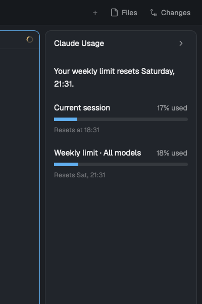

# Claude Usage for Herdr

A [Herdr](https://herdr.dev) layout with a collapsible sidebar that shows your
**Claude Code plan limits**: the current 5-hour session and the weekly limit,
each with a progress bar, the percentage used and when it resets.



- Only limits, no token counts.
- Collapses to a 44 px strip that still shows both percentages
  (click the chevron or press `cmd-shift-u`).
- Follows your Herdr theme (light and dark) and your operating system's
  language (English and Spanish included).
- No network access and no credentials: Claude Code itself hands the limits to
  a small status line script, which saves them to a local file.

## Requirements

- The Herdr app (`herdr-app`). Built and tested on macOS with Herdr app's
  `main` layout version 0.1.15. Linux and Windows are untested.
- Claude Code signed in with a **Claude subscription** (Pro or Max). Claude
  Code only reports `rate_limits` to status lines for subscribers, after the
  first response of a session. Tested with Claude Code 2.1.322.
- Python 3 on your `PATH` as `python3` (standard library only).

## Install

### 1. Add the layout and the mod

**With a Herdr agent:** in any agent inside Herdr, ask:

> Read ~/.config/herdr-app/AGENTS.md, then add this layout: herdr.dev/layouts/guilhermebussidias/claude-usage

Then continue with
step 2: the agent does not change your Claude Code settings.

**By hand:**

```sh
git clone https://github.com/guilhermebussidias/herdr-claude-usage
cd herdr-claude-usage/claude-usage
cp -R mods/claude-usage ~/.config/herdr-app/mods/
cp layouts/claude-usage.json layouts/claude-usage.svg ~/.config/herdr-app/layouts/
herdr-app check ~/.config/herdr-app/mods/claude-usage
herdr-app do layout.switch --name claude-usage
```

Do not overwrite an existing `mods/claude-usage` or `layouts/claude-usage.json`
of your own; rename first.

### 2. Connect Claude Code (status line)

Add this to `~/.claude/settings.json`:

```json
{
  "statusLine": {
    "type": "command",
    "command": "python3 ~/.config/herdr-app/mods/claude-usage/statusline.py"
  }
}
```

By default the script prints **nothing**, so Claude Code shows no extra status
line text. Options:

| You want | `command` |
|---|---|
| No status line text (default) | `python3 ~/.config/herdr-app/mods/claude-usage/statusline.py` |
| A short line: `Opus · session 17% · week 18%` | `python3 ~/.config/herdr-app/mods/claude-usage/statusline.py --summary` |
| Keep the status line you already have | `python3 ~/.config/herdr-app/mods/claude-usage/statusline.py --then "<your current command>"` |

With `--then`, the script saves the limits and then runs your existing command
with the same input, printing its output.

Send one message in Claude Code: the sidebar fills in within 30 seconds.

### 3. Keyboard shortcut (optional)

Merge this section into `~/.config/herdr-app/keys.json`:

```json
{ "layout:claude-usage": { "cmd-shift-u": "claude-usage.toggle" } }
```

It only applies while the `claude-usage` layout is shown. Note: once you edit
`keys.json`, Herdr keeps the whole file as yours and stops adding new default
shortcuts to it on upgrades. You can also toggle from a terminal with
`herdr-app do claude-usage.toggle`.

## Configure

- **Language:** Herdr has no language setting, so the mod uses the operating
  system's language (macOS `AppleLanguages`, Windows `Get-Culture`, otherwise
  `LC_ALL` / `LC_MESSAGES` / `LANG`). Unsupported languages fall back to
  English. To force one, set `props` on the `claude-usage` block in
  `~/.config/herdr-app/layouts/claude-usage.json`:

  ```json
  "content": { "mod": "claude-usage", "props": { "lang": "en" } }
  ```

  To add a language, add an entry to `STRINGS` in
  `mods/claude-usage/model.js`.
- **Width:** the sidebar opens at 300 px and collapses to 44 px
  (`OPEN_PX` / `CLOSED_PX` in `main.js`). You can drag its edge between 44 and
  480 px.

## How it works

1. On every status line refresh, Claude Code pipes a JSON object to
   `statusline.py`. The script keeps only `rate_limits.five_hour` and
   `rate_limits.seven_day` (used percentage and reset time), plus the time and
   your UTC offset, and writes them atomically to
   `~/.cache/claude-usage/limits.json`. Nothing else from the input is saved.
2. The `claude-usage` mod reads that file every 30 seconds and draws the
   sidebar. "Updated N min ago" turns to the warning color after 15 minutes
   without new data.

What the mod does on your machine: reads `~/.cache/claude-usage/limits.json`;
runs `defaults read -g AppleLanguages` (macOS), `powershell (Get-Culture).Name`
(Windows) or `sh` to read `LANG` (Linux) once, to pick the language. No
network requests.

## Limits

- Only the current session and the weekly limit (all models). Per-model weekly
  limits are not exposed to status lines, so they are not shown.
- Data refreshes only while you use Claude Code. When you don't, the sidebar
  keeps the last values and shows how old they are. A window whose reset time
  has passed shows 0 % until Claude Code reports again.
- The "auto mode on" / permission mode line at the bottom of Claude Code is
  part of Claude Code itself, not of the status line; this layout cannot hide
  it.

## Troubleshooting

- **"No data yet":** send a message in Claude Code, then check that
  `~/.cache/claude-usage/limits.json` exists. If it doesn't, check the
  `statusLine` entry and that you are signed in with a subscription.
- **Test the script by hand:**
  `echo '{"rate_limits":{"five_hour":{"used_percentage":10,"resets_at":2000000000}}}' | python3 ~/.config/herdr-app/mods/claude-usage/statusline.py --summary`
- **Mod errors:** `herdr-app check ~/.config/herdr-app/mods/claude-usage` and
  `herdr-app status`.

## Uninstall

```sh
herdr-app do layout.switch --name main
rm -r ~/.config/herdr-app/mods/claude-usage
rm ~/.config/herdr-app/layouts/claude-usage.json ~/.config/herdr-app/layouts/claude-usage.svg
rm -r ~/.cache/claude-usage
```

Remove `statusLine` from `~/.claude/settings.json` and the
`layout:claude-usage` section from `keys.json`.

## Development

```sh
node --test tests/model.test.mjs          # UI logic and translations (Node 20+)
python3 -m unittest discover -s tests     # status line script
herdr-app check claude-usage/mods/claude-usage
```

Layout:

```
claude-usage/
  layouts/claude-usage.json   main layout clone + the claude-usage sidebar block
  layouts/claude-usage.svg    picture for Herdr's layout settings
  mods/claude-usage/          main.js (UI), model.js (logic, strings),
                              statusline.py (Claude Code status line), icons
  keys.json                   optional shortcut
  RECIPE.md                   brief to rebuild it from scratch
  preview.png
tests/
```

## License

MIT, see [LICENSE](LICENSE). The chevron icons are from [Lucide](https://lucide.dev) (ISC).
