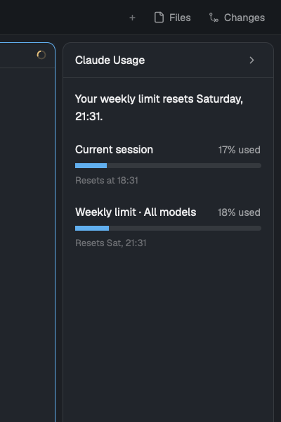

# Claude Usage

A collapsible sidebar for Herdr that shows your Claude Code plan limits: the
current 5-hour session and the weekly limit, each with a bar, the percentage
used and when it resets. Collapsed, it still shows both percentages.

## What you see

- Everything from `main` (sidebar with spaces and agents, tab bar, panes,
  Files/Changes panel, status bar), unchanged.
- At the right end of `work-body`, after the Files/Changes `panel`: a card
  300 px wide (min 44, max 480), `theme().background` fill, 1 px
  `theme().border` border, radius 10.
  - Header, 42 px, 14 px side padding, 1 px bottom border: "Claude Usage"
    (semibold, 13 px) on the left; a chevron-right icon (14 px, `muted`) on
    the right in a 4 px padded, radius 6 hover area (`hover`).
  - Body, 14 px padding, 18 px gap, scrolls:
    1. Headline, semibold 13 px: "Your weekly limit resets Saturday, 21:00."
       (full weekday, 24 h time). Hidden when there is no weekly reset ahead.
    2. Row "Current session", then row "Weekly limit · All models". Each row:
       title (13 px, `foreground`) left and "17% used" (12 px, `muted`)
       right; a 6 px bar, radius 3, track `raised`, fill `accent` (`blocked`
       at 90 % or more); below, 11 px `dim`: "Resets at 16:00" when the reset
       is today, else "Resets Sat, 21:00"; "Window reset" once passed.
    3. With no data file: "No data yet. Send a message in Claude Code so its
       status line can save your limits." (12 px, `dim`).
  - Footer, 8 px vertical padding, 1 px top border, 11 px: "Updated 2 min ago"
    in `dim`, `blocked` after 15 minutes; "Waiting for Claude Code" before any
    data.
- Collapsed: a 44 px strip, same card look: chevron-left at the top, then
  "5 h" over "17%" and "7 d" over "18%" (labels 10 px `dim`, values 11 px,
  `blocked` at 90 %+), 14 px apart.
- Text follows the OS language: English and Spanish
  ("Sesión actual", "Límite semanal · Todos los modelos", "17% usado",
  "Se restablece a las 16:00", "Se restablece el sáb, 21:00",
  "Tu límite semanal se restablece el sábado, 21:00.").

## How it behaves

- Agent statuses: unchanged from `main`; this card shows no agent state.
- Clicking either chevron toggles collapsed/expanded: it flips shared state
  `claude-usage.collapsed` (persists across restarts, shared by all copies)
  and runs `layout.resize {id: "claude-usage", px: 44 | 300}`.
- `cmd-shift-u` (keys.json section `layout:claude-usage`) sends
  `claude-usage.toggle`; `claude-usage.refresh` re-reads the file at once.
  Both also work with `herdr-app do`.
- The mod re-reads `~/.cache/claude-usage/limits.json` every 30 s. A window
  whose `resets_at` has passed shows 0 % and "Window reset" until new data
  arrives. Percentages are rounded and clamped to 0–100.
- Nothing animates.

## Built from

- Layout `layouts/claude-usage.json`: `layout.clone` of `main` (0.1.15), plus
  in row `work-body` a last child
  `{"id": "claude-usage", "type": "block", "size": {"px": 300}, "min": 44, "max": 480, "content": {"mod": "claude-usage"}}`,
  and root `"preview": "layouts/claude-usage.svg"`. Optional block
  `props: {"lang": "en" | "es"}` forces the language.
- Mod `mods/claude-usage/`:
  - `mod.json`: `{"place": "none", "title": "Claude Usage"}`.
  - `main.js`: a `View`. `init` detects the language, loads the file, starts
    `cx.timer.every(30000)` and a `nextCommand()` loop (`toggle`, `refresh`).
    Uses `readTextFile`, `home`, `exec`, `props`, `window().platform`, `run`,
    `shared`, `setShared`, `theme`. Bars are two `flex_grow` divs (pct and
    100 − pct).
  - `model.js`: pure functions and the `STRINGS` table (no imports, so Node
    tests it): `pickLanguage`, `firstAppleLanguage`, `wallTime`,
    `usedPercent`, `resetText`, `weeklyHeadline`, `updatedText`, `isStale`.
  - `statusline.py`: Claude Code `statusLine` command. Reads the status line
    JSON from stdin, keeps `rate_limits.five_hour` / `seven_day`
    (`used_percentage`, `resets_at`), adds `updated_at` and `tz_offset_min`,
    writes `~/.cache/claude-usage/limits.json` atomically, prints nothing.
    `--summary` prints `Model · session N% · week N%`; `--then "<cmd>"` runs
    an existing status line command with the same stdin.
  - Art: `chevron-left.svg`, `chevron-right.svg` (Lucide, tinted by
    `text_color`).
- Programs run: once at start, `defaults read -g AppleLanguages` (macOS),
  `powershell -NoProfile -Command (Get-Culture).Name` (Windows) or
  `sh -c 'printf %s "${LC_ALL:-${LC_MESSAGES:-$LANG}}"'` (Linux).
- Claude Code: `~/.claude/settings.json`
  `"statusLine": {"type": "command", "command": "python3 ~/.config/herdr-app/mods/claude-usage/statusline.py"}`.

## Watch out

- Herdr has no language setting; the JS runtime's `Intl` is not relied on.
  Times are computed from epoch + the offset saved by Python, using UTC
  getters, so they don't depend on the runtime's time zone support.
- `rate_limits` only exists for Claude subscribers, after the first response,
  and each window only while its `resets_at` is in the future. Never
  overwrite the file when the input has no limits.
- Per-model weekly limits (shown in Claude's own usage page) are not in the
  status line input; don't promise them.
- Data only updates while Claude Code runs; show its age.
- Don't save the file under `~/.config/herdr-app/mods/`: saving files there
  reloads the mod.
- There is no `rotate()` on elements: use two chevron SVGs.
- The status line prints nothing by default, so it replaces nothing visible;
  people who already have a status line need `--then`.
- Tested on macOS only.

## Done when

- `herdr-app check ~/.config/herdr-app/mods/claude-usage` passes and
  `herdr-app status` lists no errors with the layout shown.
- `node --test tests/model.test.mjs` and
  `python3 -m unittest discover -s tests` pass.
- After one Claude Code message, `~/.cache/claude-usage/limits.json` exists
  with `five_hour`, `seven_day`, `updated_at`, `tz_offset_min` only, and the
  card shows the same percentages as Claude's usage page.
- `herdr-app do claude-usage.toggle` collapses the card to 44 px with both
  percentages and back to 300 px; the choice survives a restart.
- With `props.lang` `"es"` the card is in Spanish, with `"en"` in English.
- Claude Code shows no status line text with the default command.
